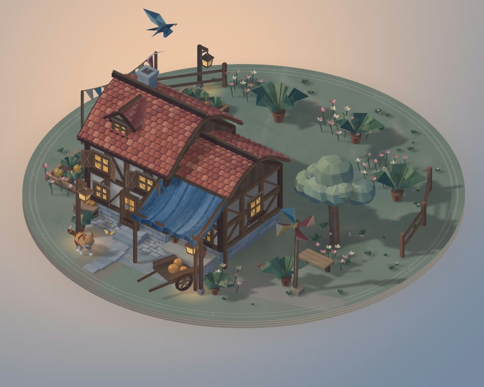

# 纸境 · Paperfold

一个制作圆形折纸微缩景观的 Agent Skill。两张立页绕同一条竖直书脊展开 360°，扇形纸地随折痕摊开，构件依次立起。纸页收进底座后，景观里的活动继续发生。



技能把《风过瓦檐 · 燕起灯时》的开场引导、结构揭晓和展开后的余韵转成创作流程。新作品可以随题材决定画风、色彩、节奏和结尾。[样片拍点与审片方法](skills/paperfold/references/direction.md)

## 一句话交给 Agent

复制下面这句话给 Codex、Claude Code 或其他支持 Agent Skills 的助手。

> 请从 https://github.com/Rain-dust/paperfold 安装 `paperfold` 技能到当前项目，按仓库 README 验证安装，并告诉我如何调用。

### 单命令安装

在你要使用技能的项目目录运行。需要 Git、Node.js 和 npm。把 `codex` 换成 `claude-code` 或你使用的 [Agent 标识](https://github.com/vercel-labs/skills#supported-agents)。

```sh
npx --yes skills add Rain-dust/paperfold --skill paperfold --agent codex --copy --yes
```

命令默认安装到当前项目。需要跨项目使用时可加 `--global`。安装后检查 CLI 报告的目录是否包含 `SKILL.md`、`references/direction.md` 和完整的 `assets/turning-garden/`，然后在 Agent 的技能列表里查找 `paperfold`。如果已打开的会话还未显示，刷新技能列表或从目标项目新开会话。

已有原生安装器的 Agent 也可以按宿主约定，把仓库里的 [`skills/paperfold/`](skills/paperfold/) 整个目录放到它识别的技能目录。Codex 的项目目录入口为 `.agents/skills/paperfold/`。

## 安装后这样用

> 用 `$paperfold` 做一段竖屏黑白版画风的手摇印刷工坊短片。纸地展开，支架和滚筒依次立起，最后看一张纸被压成海报。交付可编辑网页和 MP4。

也可以只让 Agent 给分镜、做交互网页，或修改已有动画。支持技能的宿主可以按名称调用，Codex 可用 `$paperfold`。

## 预览与导出

- **离线预览**。克隆或下载仓库后，用支持 WebGL 的浏览器打开 [示例的 `index.html`](skills/paperfold/assets/turning-garden/index.html)。可以拖纸边开合，点橘猫、路灯或风车，晃动视角看院子的背面。
- **改造模板**。把 `assets/turning-garden/` 整份复制到作品目录，再改造型、折叠顺序、相机和角色动线。文件入口与时间线说明见 [制作与导出](skills/paperfold/references/production.md)。
- **导出 PNG 或 MP4**。使用技能中的 `scripts/render.cjs`。需要 Node.js 20+ 和 Playwright/Chromium，导出 MP4 还需要 PATH 中的 FFmpeg。交互模板可直接打开，渲染依赖按需安装。

从仓库根目录运行以下命令可验证并渲染模板。

```sh
node scripts/check-skill.cjs
npm install --no-save --package-lock=false playwright
npx playwright install chromium
node skills/paperfold/scripts/render.cjs skills/paperfold/assets/turning-garden/index.html wind-over-eaves.mp4 --fps 60 --width 1920 --height 1536
```

## 安装与使用（English）

Ask your agent to install `paperfold` from https://github.com/Rain-dust/paperfold in the current project, verify the installation against this README, and report how to invoke it. The CLI command above installs the skill for Codex. After installation, ask for a new scene by naming `paperfold` and specifying a subject and deliverables.

The [direction and review guide](skills/paperfold/references/direction.md) uses a reference film to explain how to guide attention from the first cue through a physical reveal to a readable ending. The bundled example is an editable, offline WebGL diorama. It includes an animated radial fold, day-to-dusk lighting, live props, and touch controls. The frame renderer supports PNG or H.264 MP4 with an optional separate audio track.

## 来源

折纸灵感来自 Unfold。圆形地台、纸页插画、模型与交互由《风过瓦檐》工程实现。示例中使用的 CC0 实录音效见素材清单。[Unfold](https://github.com/Dksie09/unfold) · [音效来源](skills/paperfold/assets/turning-garden/AUDIO.md) · [Agent Skills 格式](https://agentskills.io/specification)
