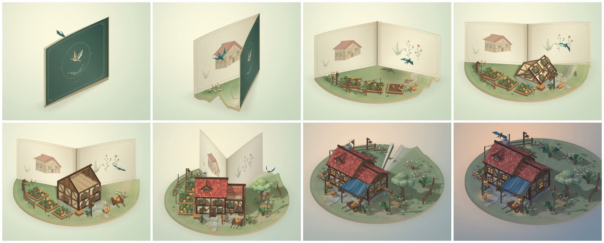

# 设计与审片

## 从《风过瓦檐 · 燕起灯时》提取的设计

这支成片为 12 秒。图中是成片画面，先看上排，再看下排，每排从左到右。

| 画面时间 | 观众看到什么 | 可迁移的设计决定 |
| --- | --- | --- |
| 0.0、1.2 秒 | 深色封面有纸燕徽记，另一只纸燕在书脊顶沿动起来，飞进浅色内页。 | 先在安静的构图里建立一个能识别的轮廓，随即用它的动作把视线带进展开的空间。 |
| 3.8、5.4 秒 | 低对比的房屋和植物图留在内页，花圃与小径先围出尺度，主屋从地面的平面轮廓开始起立。 | 提前给主景一个能记住的平面线索。先展示一两次易懂的小展开，让观众明白纸面的规则，再把注意力集中给主揭晓。 |
| 6.2、8.3 秒 | 主屋的木框和墙体立稳，屋面逐层铺合。较小的外廊、布棚与树随后补足环境。 | 把惊喜拆成可以预期下一步的建造动作。让后到的元素补充功能、关系或深度，每一拍留一个最强的动作。 |
| 9.6、11.4 秒 | 立页压低并收进底座，暮色和暖灯接过视线。纸燕回到屋顶上方，暖光下的石径上还有一个小动作。 | 大结构完成后，用一件这个场景特有的事回收前面的线索。给状态变化和最终构图各留出可感知的时间。 |

柔和感来自连续变化和清楚的主次。浅底和留白让封面、展开前沿与最终轮廓好辨认，机位和尺度缓慢交接，纸页张开、屋架接触和瓦片落定的声音各有轻重，接触之间有空隙。 [样片音效来源](../assets/turning-garden/AUDIO.md)

可以用强对比、鲜艳色或更快的节拍，只要每个重要变化仍有进入、看清和被下一拍接住的时间。与同样采用庭院模型的《风起庭院》相比，《燕起灯时》的封面徽记呼应了活燕，结束时也多了一次由暮色和暖灯带来的状态变化。新题材可以用自己的图形、动作、材料和最终状态建立这种联系。

## 在新题材中建立自己的拍点

先用一句话定下展开的前后变化，例如某种结构出现后，一项原本做不到的动作终于能发生。根据主题选主景、材料、镜头关系和余韵。题材开放时，快速比较两个由不同事件揭晓和收束的构想，选一个能借纸的展开讲清楚的。用户已经给出方向时，从现有方向往下做。

用简短的拍点表或草图排出开场、主揭晓和收束，需要时加入承接段。每拍能回答四件事。

- **先看哪里**。给观众一个在发布尺寸下仍辨认得出的形、光、动作或空间关系。
- **怎么接过来**。写出把眼睛从上一个重点带到这里的具体线索。角色可以引路，折痕、阴影、路径和色块也可以。
- **为什么这时动**。标出纸地边界、铰点、支承先后和动作缓急。让小结构先教会观众看法，给主结构留出辨认空间。
- **最后有什么回响**。用动作、空间关系或材质变化，把开场的期待兑现。预留足够的可播放时间，让这个变化完整发生。

试排闭合态、主揭晓前后和最终态。缩小预览，检查主体剪影、前缘的方向和运动路线，再做低成本动态样片。先解决机位、结构与节奏，再铺细节。用至少一个题材固有的形态或活动改变主构件怎样出现、视线怎样走或结束时发生什么。

| 题材与画面 | 开场与主揭晓 | 展开以后 |
| --- | --- | --- |
| 黑白网点印刷的山顶气象站，窄幅仰视，透明描图纸作风向层。 | 封面上一截在抖的刻度线引到未成形的站台。沿折边立起三脚架，支脚全部落定后，天线顺着支点转到工作位。 | 一阵风依次翻动近端和远端风标，最终指向同一方向。保留一瞬让人读出站台与风向的关系。 |
| 高彩纸浆拼贴的潮沟，以横幅呈现低矮起伏和大片水域。 | 封面上露出半条亮色潮线。地纸铺开时，两层被压扁的岸边纸带先后抬起，露出整条互通的水路。 | 一小股潮水走完两条支流，略有迟滞地带动不同位置的芦苇，最后地形与流向同时可见。 |

## 让主角和环境按同一个世界的规则运动

先给视线主角写一句可表演的因果。秋谷的叶片被风卷起，沿页边掠过树冠，落水后由水带走。港口的运货车沿纸轨接力过桥，桥段就位后才能抵达码头。用移动方向、转身、停靠或光的变化，把注意力交给沿途要揭晓的事物。让主角在第一次观看时有辨认轮廓和走向的时间。

安排环境时，先写动作由什么触发，再决定哪些地方一起响应。风经过树冠、细枝和岸草时，启动先后、弯曲幅度和回弹速度各有差异。水沿河槽、坡度或潮线移动，可以用一枚漂浮物或几段反光验证流向。溪流可让主流比近岸快，落水先有局部涟漪，漂流时才留短尾波。把最大的位移或最强的反差留给这一拍的重点，纸页停住后仍让场景按自己的节奏活动。

## 审片与返修

用实际目标画幅和发布时常见的显示尺寸审片。先按成片速度静音看一遍，有声的作品再开声音看一遍。回看有疑问的拍点前、中、后，确认这是有意的变化。互动作品走一遍普通观众会用的入口，并反向拖过刚才看过的折叠区间。分镜和静帧只检查当前交付能验证的部分。

| 检查 | 通过时应看到或听到的证据 | 失败时先修哪里 |
| --- | --- | --- |
| 注意力交接 | 第一眼能指出开场的注意点，能一路找到主揭晓，最后知道该停在哪里。 | 削弱抢视线的运动和高对比物，重排机位、方向或出场时机。 |
| 结构和纸感 | 主要构件的平面线索、翻折路径和落点读得出来。主角经过折边、形体和水岸时，外轮廓和接触关系连贯。 | 查扇区、铰点、支承和完整轮廓。逐帧回看擦边、入水和退场，必要时换侧视。[净空检查](production.md#检查主角净空与材质) |
| 环境动势 | 树草、水纹等在主角附近有明确原因和可读的方向，强弱错开。 | 先校对风或水的方向，再错开不同材质的动作开端和幅度。检查重要变化是否足以在正常速度下看清。 |
| 收束和余韵 | 大结构落定后仍能看完一段变化，末帧同时保住主景与变化结果。 | 提早完成纸页退场或腾出时间。给主体动作安排清楚的起落，压低背景干扰。 |
| 音画与成片 | 静音时能跟上。带声音时，重点声在可见变化附近发生，尾声和末帧的收束完整。 | 对可见接触和段落边界重新剪音，保留轻重与空隙，回看导出的首尾和声画同步。 |

有一项失去可读性，就先修影响最大的那个拍点，再重看它前后的交接和整段预演。交付前复查导出件，把实际通过的关键时间或互动状态和无法验证的部分如实写在交付说明中。此处以成片的可读性、完成度和体验为质量基准，传播表现由具体发布环境决定。
